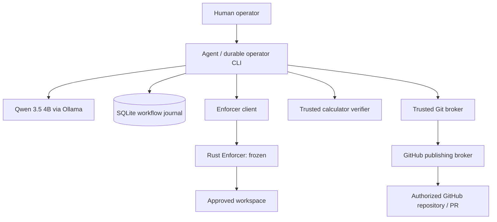
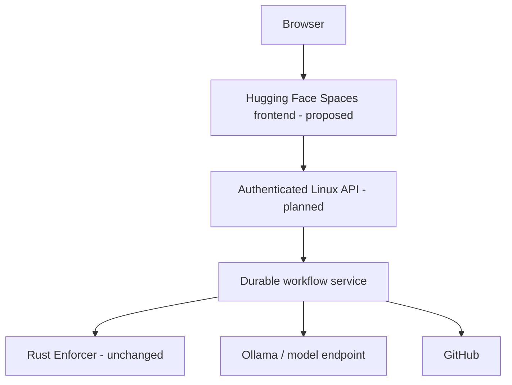

# Secure SWE Agent — Current Architecture and Trust Boundaries

_Last updated: 2026-10-26._

## System context

This is a **logical** view, not a claim that every step is currently mediated by one deployed service. Existing CLI workflows and durable adapters have been developed incrementally.

## Responsibility split

| Subsystem | Responsibility | Not authorized to do |
| --- | --- | --- |
| Qwen/agent | Task interpretation, file selection from approved catalog, code proposal | Direct privileged filesystem access, arbitrary shell, credentials |
| Python workflow layer | Task coordination, approval checkpoints, journal, recovery | Treat an LLM response as authorization |
| Rust Enforcer | Existing filesystem authorization, versioned mutation, fixed probes, audit | Arbitrary agent code execution in current prototype |
| Trusted verifier | Execute operator-controlled calculator tests | Run arbitrary hostile repository code |
| Git broker | Stage/review exact changes and commit on authorized task branches | Direct commits to protected default branch |
| GitHub broker | Validate destination and approval; push branch and create/recover PR | Force push, expose token to model |
| Future UI | Present status, diffs, approvals and results | Perform privileged operations directly |

## Approval boundaries

1. **Change approval:** Human reviews the exact proposal; application checks proposal fingerprint and source version.
2. **Commit approval:** Human reviews the staged diff; broker checks the fingerprint again before commit.
3. **Publication approval:** Human reviews repository, branch, commit, base, title and body; broker checks the exact plan before push/PR.

A frontend approval button must invoke a backend operation bound to immutable server-side review evidence. A UI-visible hash is not itself an authorization mechanism.

## Durable state and uncertain effects

The SQLite journal records workflow identity, transitions, revisions, events and ownership/recovery metadata. External effects are not transactional with SQLite. A crash can occur after a file change, commit, push or PR creation but before the journal records completion.

Therefore, an interrupted operation should enter a reconciliation-required state. Recovery should collect read-only evidence, validate ownership and original approval, and require trusted operator intervention when the outcome is uncertain. Never blindly replay an external operation.

## Linux/Windows division

Windows is suitable for local model orchestration, proposal generation, unit tests and frontend development. The approved E2 versioned file-application path has been demonstrated on Linux. The final hosted demo should keep the backend/Enforcer on Linux and expose only a narrowly authenticated application API to the frontend.

## Proposed hosting, not yet deployed

Do not publicly expose the raw Enforcer protocol, SQLite database, Ollama, Git credentials, or trusted fixture runner. A public UI requires user authentication, per-task authorization, request limits, origin restrictions, auditability and a deployment threat model.
