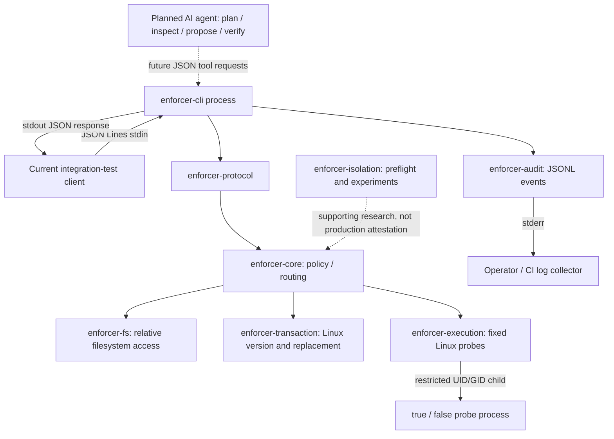

# Secure SWE Agent architecture — current and planned

This repository is the **Secure SWE Agent** project. The Rust Enforcer is its first implemented subsystem. The autonomous AI agent is planned and **not part of the v0.1.0 release**.

## Unified architecture

**Legend:** solid lines represent current functional flow; the dashed agent edge is planned. This diagram is a logical map, not a claim that the agent or a full general-purpose sandbox exists today.

## Current crate responsibilities

| Crate | Responsibility in the current milestone |
| --- | --- |
| `enforcer-cli` | JSONL framing, request dispatch, stdout responses, stderr audit |
| `enforcer-protocol` | Request and response types |
| `enforcer-core` | Policy and operation routing |
| `enforcer-fs` | Workspace-relative file access |
| `enforcer-transaction` | Linux snapshot, version validation and replacement candidate |
| `enforcer-execution` | Fixed `true` and `false` subprocess probes |
| `enforcer-audit` | JSONL audit serialization |
| `enforcer-isolation` | Preflight and experimental OS isolation checks |

## Processes and trust boundaries

1. The current client or integration harness sends one JSON request per line to the trusted `enforcer-cli` process.
2. The CLI parses the request, dispatches policy evaluation, returns JSON on stdout and writes audit events to stderr.
3. For Linux E3 fixed probes, the Enforcer launches a separate process under a non-root identity. That is **not** a complete agent sandbox.
4. The future AI agent must remain an untrusted request producer and must not execute arbitrary generated code using Enforcer authority.

## Planned integration within this repository

Future agent components will include task planning, code understanding, tool orchestration, feedback and verification. Their interfaces, implementation language and exact directory structure are **not finalized**. Do not confuse planned components with implemented crates.

## Release boundary

[v0.1.0](releases/v0.1.0.md) is the **Enforcer functional milestone of Secure SWE Agent**, not the release of a complete autonomous agent. See [security limitations](../SECURITY.md).
